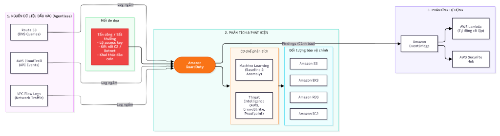

# AMAZON GUARDDUTY – HOW DOES AWS AUTOMATICALLY DETECT SECURITY THREATS?

In cloud computing environments, cyberattacks occur continuously and are becoming increasingly sophisticated: from leaked IAM access keys exploited through anonymous IP addresses and compromised EC2 virtual servers used for crypto-mining, to data exfiltration from S3 storage.

For example:

An attacker obtains an aws_access_key_id and aws_secret_access_key pair, then immediately makes a series of API calls from the anonymous Tor network to escalate privileges (Privilege Escalation) and launch large, high-specification EC2 clusters in a Region the organization has never used.

With only manual checks or static rule-based log queries, engineering teams quickly become overwhelmed by millions of raw log entries and miss the critical opportunity to intervene. To address continuous security monitoring, AWS provides Amazon GuardDuty — an Intelligent Threat Detection service that combines Machine Learning (ML), Anomaly Detection, and Threat Intelligence to protect AWS accounts and resources fully automatically.

## WHAT MAKES AMAZON GUARDDUTY NOTEWORTHY?

GuardDuty acts as an intelligent IDS across the entire cloud environment, continuously analyzing actual activity streams on AWS resources.

Some core capabilities:

**No agent required (Agentless Architecture):** GuardDuty consumes data directly from AWS's underlying infrastructure (CloudTrail Event Logs, VPC Flow Logs, and DNS Query Logs). The service does not require monitoring software on EC2, consumes no CPU/RAM, and does not require enabling raw log storage in CloudWatch Logs, significantly reducing infrastructure costs.

**Learning a baseline with Machine Learning:** The system automatically learns and establishes the account's normal operating state (IP locations that commonly call APIs, EC2 types commonly launched, and internal DNS query patterns). When a sudden deviation occurs, it compares the activity and classifies the risk level (Low, Medium, High).

**Continuously updated Threat Intelligence:** Automatically compares traffic against threat databases from AWS Security and trusted security partners (CrowdStrike, Proofpoint) to identify malicious IP addresses, botnets, and Tor network nodes.

**In-depth protection for critical services (optional, separately charged):**

- **S3 Protection:** Detects unusual data read/write behavior or attempts to disable bucket encryption and logging.
- **EKS & Container Protection:** Analyzes EKS audit logs and supports Runtime Monitoring (optional, through a lightweight daemon agent) to monitor process and file behavior inside containers.
- **RDS Protection:** Identifies password brute-force attacks or suspicious logins to Aurora/RDS database clusters.
- **Lambda Protection:** Monitors unusual network calls from serverless Lambda functions.
- **Malware Protection (EC2 only):** Automatically creates EBS disk snapshots and independently scans for malware (Trojans, worms, rootkits) when signs of EC2 compromise are detected, without interrupting running applications.

## USE CASES AND PRACTICAL BENEFITS

GuardDuty is a central component of automated monitoring and Incident Response workflows:

**Detecting Compromised Credentials:** Alerts when IAM credentials are used from low-trust IP addresses, call sensitive APIs at unusual hours, or perform resource reconnaissance.

**Detecting C2 connections (Command & Control Beaconing):** Identifies EC2 instances or containers silently sending signals to attackers' C2 domains or participating in botnets carrying out DDoS attacks.

**Key benefits:**

- **Enable with one click:** No need to write complex rules or maintain log analysis server clusters; protection starts as soon as the service is enabled.
- **Centralized management at scale:** Integrates directly with AWS Organizations, allowing the Security Tooling account to automatically enable GuardDuty across all member accounts and consolidate alerts into a single management console.

## WHEN SHOULD YOU USE IT, AND WHAT SHOULD YOU CONSIDER?

**Detection, not Prevention:** GuardDuty focuses on threat detection; it does not actively block traffic like a WAF or firewall. Combine it with EventBridge and Lambda to build automated response and incident isolation workflows.

**Coordinated in-depth investigation:** Works seamlessly with AWS Security Hub (centralized finding management) and Amazon Detective (tracing interaction graphs and analyzing attack root causes).

## CONCLUSION

Amazon GuardDuty addresses the bottleneck in big-data analysis by applying Machine Learning to analysis of underlying logs. It is an important defensive component and is considered a foundational Security Baseline that every AWS infrastructure architecture should enable to proactively identify threats as soon as they emerge.

## REFERENCES

- AWS – What is Amazon GuardDuty?: https://docs.aws.amazon.com/guardduty/latest/ug/what-is-guardduty.html
- AWS – Amazon GuardDuty Pricing: https://aws.amazon.com/guardduty/pricing/
- AWS – GuardDuty finding types: https://docs.aws.amazon.com/guardduty/latest/ug/guardduty_finding-types-active.html

#AWS #AmazonGuardDuty #CloudSecurity #AWSStudyGroupVN #FCAJ

[Open source document (OneDrive)](https://1drv.ms/w/c/b0f7e1f2c77d799c/IQDGLYCjpXbcQoKPxQ3l6y2XAQkqsuCEFT_eDAjJ7WGbbn8?e=cKqslP)

> Source document provided by the user; the publication date or AWS Study Group post link has not been verified.

### Architecture diagram

