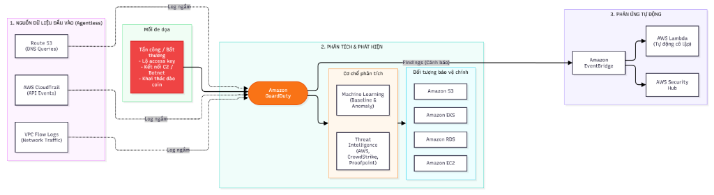

# AMAZON GUARDDUTY – AWS PHÁT HIỆN MỐI ĐE DỌA BẢO MẬT TỰ ĐỘNG NHƯ THẾ NÀO?

Trong môi trường điện toán đám mây, các cuộc tấn công mạng diễn ra liên tục với mức độ ngày càng tinh vi: từ lộ lọt khóa truy cập (IAM access keys) bị khai thác qua IP nặc danh, máy chủ ảo EC2 bị chiếm quyền để đào tiền ảo (crypto-mining), cho đến rò rỉ dữ liệu (data exfiltration) từ kho lưu trữ S3.

Ví dụ:

Kẻ tấn công thu thập được cặp khóa aws_access_key_id và aws_secret_access_key, sau đó lập tức gọi hàng loạt API từ mạng ẩn danh Tor nhằm leo thang đặc quyền (Privilege Escalation) và khởi tạo các cụm EC2 cấu hình khủng ở một Region mà doanh nghiệp chưa từng sử dụng.

Nếu chỉ kiểm tra thủ công hoặc viết các câu lệnh truy vấn log tĩnh (rule-based queries), đội ngũ kỹ thuật sẽ nhanh chóng bị quá tải bởi hàng triệu dòng log thô và bỏ lỡ thời điểm vàng để can thiệp. Để giải quyết bài toán giám sát an ninh liên tục, AWS cung cấp Amazon GuardDuty — dịch vụ phát hiện mối đe dọa thông minh (Intelligent Threat Detection) kết hợp giữa Machine Learning (ML), phát hiện hành vi bất thường (Anomaly Detection) và Threat Intelligence để bảo vệ tài khoản cũng như tài nguyên AWS hoàn toàn tự động.

## AMAZON GUARDDUTY CÓ GÌ ĐÁNG CHÚ Ý?

GuardDuty hoạt động như một hệ thống IDS thông minh ở cấp độ toàn bộ môi trường cloud, liên tục phân tích các luồng hoạt động thực tế trên tài nguyên AWS.

Một vài khả năng cốt lõi:

**Không cần Agent (Agentless Architecture):** GuardDuty tiêu thụ dữ liệu trực tiếp từ hạ tầng ngầm của AWS (CloudTrail Event Logs, VPC Flow Logs và DNS Query Logs). Dịch vụ không yêu cầu cài đặt phần mềm giám sát lên EC2, không tốn CPU/RAM và không bắt buộc phải bật lưu trữ log thô về CloudWatch Logs, giúp tiết kiệm đáng kể chi phí hạ tầng.

**Học baseline bằng Machine Learning:** Hệ thống tự động học và thiết lập trạng thái hoạt động bình thường của tài khoản (vị trí IP thường gọi API, loại EC2 hay khởi tạo, mẫu truy vấn DNS nội bộ). Khi có sai lệch đột biến, hệ thống sẽ đối chiếu và phân loại mức độ rủi ro (Low, Medium, High).

**Threat Intelligence liên tục cập nhật:** Tự động đối chiếu lưu lượng truy cập với kho dữ liệu mối đe dọa từ AWS Security cùng các đối tác an ninh uy tín (CrowdStrike, Proofpoint) để nhận diện IP độc hại, mạng botnet và node mạng Tor.

**Bảo vệ chuyên sâu cho các dịch vụ trọng yếu (tùy chọn, tính phí riêng):**

- **S3 Protection:** Phát hiện hành vi đọc/ghi dữ liệu bất thường hoặc nỗ lực vô hiệu hóa cơ chế mã hóa, logging của bucket.
- **EKS & Container Protection:** Phân tích audit log EKS và hỗ trợ Runtime Monitoring (tùy chọn, qua daemon agent gọn nhẹ) để giám sát hành vi tiến trình, tập tin bên trong container.
- **RDS Protection:** Nhận diện tấn công brute-force mật khẩu hoặc đăng nhập đáng ngờ vào cụm cơ sở dữ liệu Aurora/RDS.
- **Lambda Protection:** Giám sát các lệnh gọi mạng bất thường từ hàm Lambda serverless.
- **Malware Protection (chỉ cho EC2):** Tự động tạo snapshot ổ đĩa EBS và quét mã độc (Trojan, worm, rootkit) độc lập khi phát hiện EC2 có dấu hiệu bị xâm nhập mà không làm gián đoạn ứng dụng đang chạy.

## CÁC TRƯỜNG HỢP SỬ DỤNG VÀ LỢI ÍCH THỰC TẾ

GuardDuty là mắt xích trung tâm trong quy trình giám sát và phản ứng sự cố (Incident Response) tự động:

**Phát hiện thông tin định danh bị xâm nhập (Compromised Credentials):** Cảnh báo khi IAM credential bị dùng từ IP có độ tin cậy thấp, gọi API nhạy cảm vào khung giờ lạ hoặc thực hiện hành vi trinh sát tài nguyên (reconnaissance).

**Phát hiện kết nối C2 (Command & Control Beaconing):** Nhận diện EC2 instance hoặc container âm thầm gửi tín hiệu ra domain C2 của hacker hoặc tham gia vào mạng botnet thực hiện DDoS.

**Lợi ích nổi bật:**

- **Kích hoạt chỉ bằng một cú nhấp:** Không cần viết rule phức tạp hay duy trì cụm máy chủ phân tích log; bật dịch vụ là hệ thống bảo vệ ngay lập tức.
- **Quản trị tập trung quy mô lớn:** Tích hợp trực tiếp với AWS Organizations, cho phép tài khoản Security Tooling tự động bật GuardDuty trên tất cả tài khoản thành viên và gom toàn bộ cảnh báo về một trang quản trị duy nhất.

## KHI NÀO NÊN DÙNG VÀ CẦN LƯU Ý GÌ?

**Detection chứ không phải Prevention:** GuardDuty tập trung vào phát hiện mối đe dọa, không chủ động chặn luồng traffic như WAF hay Firewall. Cần kết hợp với EventBridge và Lambda để xây dựng kịch bản tự động xử lý và cô lập sự cố.

**Phối hợp điều tra chuyên sâu:** Kết hợp hoàn hảo với AWS Security Hub (quản lý tập trung các finding) và Amazon Detective (truy vết đồ thị tương tác, phân tích nguyên nhân gốc rễ cuộc tấn công).

## KẾT LUẬN

Amazon GuardDuty giải quyết nút thắt cổ chai trong phân tích dữ liệu lớn bằng cách đưa Machine Learning vào phân tích log ngầm. Đây là thành phần phòng thủ quan trọng và được xem là một tiêu chuẩn an ninh nền móng (Security Baseline) mà mọi kiến trúc hạ tầng trên AWS đều nên kích hoạt để chủ động nhận diện mối đe dọa ngay khi chúng vừa xuất hiện.

## NGUỒN THAM KHẢO

- AWS – What is Amazon GuardDuty?: https://docs.aws.amazon.com/guardduty/latest/ug/what-is-guardduty.html
- AWS – Amazon GuardDuty Pricing: https://aws.amazon.com/guardduty/pricing/
- AWS – GuardDuty finding types: https://docs.aws.amazon.com/guardduty/latest/ug/guardduty_finding-types-active.html

#AWS #AmazonGuardDuty #CloudSecurity #AWSStudyGroupVN #FCAJ

[Mở tài liệu nguồn (OneDrive)](https://1drv.ms/w/c/b0f7e1f2c77d799c/IQDGLYCjpXbcQoKPxQ3l6y2XAQkqsuCEFT_eDAjJ7WGbbn8?e=cKqslP)

> Tài liệu nguồn do người dùng cung cấp; chưa xác nhận ngày xuất bản hoặc liên kết đăng trên AWS Study Group.

### Sơ đồ kiến trúc

