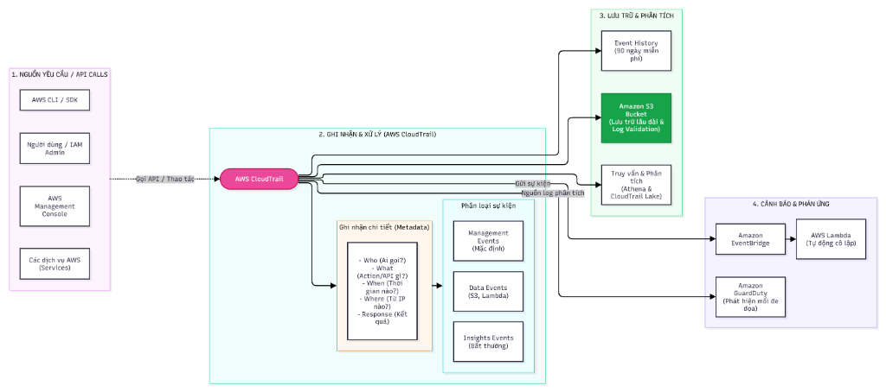

# AWS CLOUDTRAIL – AWS GHI LẠI MỌI HÀNH ĐỘNG TRONG TÀI KHOẢN NHƯ THẾ NÀO?

Summary: AWS CloudTrail records API activity for auditing, including management and data events; trails store records in Amazon S3 and CloudTrail Lake supports compliance queries.

[Open source document (OneDrive)](https://1drv.ms/w/c/b0f7e1f2c77d799c/IQANtZk0Ub8DSYDaoiFIAGCDAZJjVecLEt7lWJ3r-zDSJZ4?e=ld5YUt)

> User-provided source document; publication date and AWS Study Group publication link have not been confirmed.

### Architecture diagram

