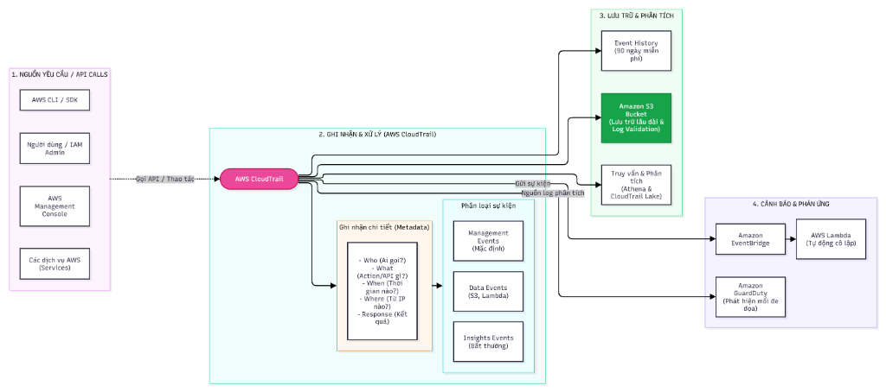

# AWS CLOUDTRAIL – AWS GHI LẠI MỌI HÀNH ĐỘNG TRONG TÀI KHOẢN NHƯ THẾ NÀO?

Khi vận hành hệ thống trên AWS, bạn thường đặt câu hỏi: Ai đã xóa S3 bucket đó? Ai đã mở security group cho toàn bộ internet? Ai đã tạo IAM user mới vào lúc 3 giờ sáng? Nếu không có nhật ký hoạt động, bạn sẽ không thể trả lời, càng không thể điều tra khi sự cố xảy ra.

Ví dụ:

Một nhân viên vô tình commit access key lên GitHub. Kẻ tấn công dùng key đó để gọi API tạo EC2 instance ở Region chưa từng dùng, rồi xóa dấu vết bằng cách tắt CloudTrail. Nếu không có nhật ký độc lập, bạn sẽ không biết chuyện gì đã xảy ra, từ IP nào, vào thời điểm nào.

Để giải quyết bài toán "không thể điều tra những gì không được ghi lại", AWS cung cấp **AWS CloudTrail** — dịch vụ ghi lại mọi lệnh gọi API trong tài khoản AWS của bạn, hoạt động tự động ngay khi tài khoản được tạo, và là nền tảng cho hầu hết các dịch vụ bảo mật khác.

## AWS CLOUDTRAIL CÓ GÌ ĐÁNG CHÚ Ý?

CloudTrail hoạt động như một "hộp đen" của tài khoản AWS, ghi lại tất cả các hoạt động quản lý và truy cập dữ liệu.

**Khả năng cốt lõi:**

- **Event history miễn phí có sẵn:** Ngay khi tạo tài khoản, bạn có thể xem 90 ngày gần nhất của các sự kiện quản lý (management events) trực tiếp trong console CloudTrail, không cần cấu hình gì thêm.
- **Ghi lại mọi lệnh gọi API:** Từ Console, CLI, SDK đến các dịch vụ AWS gọi lẫn nhau, tất cả đều được ghi lại với thông tin: ai gọi, từ IP nào, vào thời điểm nào, kết quả ra sao.
- **Trail để lưu trữ lâu dài:** Tạo Trail để gửi log vào S3 bucket, cho phép lưu trữ vĩnh viễn, phân tích bằng Athena, hoặc chuyển sang các công cụ SIEM.
- **CloudTrail Lake:** Truy vấn log bằng SQL trực tiếp trong CloudTrail, không cần thiết lập thêm.

**Phân loại sự kiện:**

- **Management events:** Các thao tác quản lý tài nguyên (tạo EC2, sửa IAM policy, xóa S3 bucket). Được ghi mặc định.
- **Data events:** Các thao tác trên dữ liệu (GetObject, PutObject trên S3; Invoke trên Lambda). Phải bật riêng và tính phí.

## CÁC TRƯỜNG HỢP SỬ DỤNG VÀ LỢI ÍCH THỰC TẾ

CloudTrail là nền tảng cho mọi quy trình bảo mật và vận hành:

**Điều tra sự cố (Incident Response):** Khi phát hiện bất thường (từ GuardDuty hoặc báo cáo thủ công), CloudTrail là nơi đầu tiên bạn tra cứu: ai đã làm gì, từ IP nào, vào thời điểm nào.

**Kiểm toán tuân thủ (Compliance Audit):** Nhiều tiêu chuẩn (PCI DSS, HIPAA, SOC) yêu cầu phải có nhật ký hoạt động đầy đủ và không thể xóa. CloudTrail cung cấp bằng chứng cho kiểm toán.

**Phát hiện thay đổi cấu hình nguy hiểm:** Bạn có thể tạo cảnh báo khi có ai đó tắt CloudTrail, xóa Trail, hoặc thay đổi retention policy của S3 log bucket.

**Lợi ích nổi bật:**

- **Tự động, không cần cấu hình:** Event history có sẵn ngay, không cần bật gì.
- **Miễn phí ở mức cơ bản:** 90 ngày event history miễn phí; Trail gửi log vào S3 chỉ tốn phí lưu trữ S3.
- **Là nền tảng cho các dịch vụ khác:** GuardDuty phân tích CloudTrail events để phát hiện mối đe dọa; Security Hub tổng hợp findings từ CloudTrail.

## KHI NÀO NÊN DÙNG VÀ CẦN LƯU Ý GÌ?

**CloudTrail không tự động phát hiện tấn công:** Nó chỉ ghi lại. Để phát hiện bất thường, bạn cần GuardDuty hoặc tự viết rule trên CloudTrail Lake/EventBridge.

**Cần bảo vệ log:** Nếu kẻ tấn công xóa Trail hoặc S3 bucket chứa log, bạn mất bằng chứng. Nên bật **log file validation, MFA delete** trên S3 bucket, và gửi log sang tài khoản riêng (Log Archive Account) trong AWS Organizations.

**Về chi phí:** Event history 90 ngày miễn phí. Trail gửi management events vào S3 miễn phí (chỉ tốn phí S3 storage). Data events (S3 object-level, Lambda Invoke) tính phí riêng, nên bật chọn lọc theo nhu cầu.

## KẾT LUẬN

AWS CloudTrail là dịch vụ **nền tảng nhất** trong bảo mật AWS: không có CloudTrail, bạn không thể điều tra, không thể kiểm toán, và các dịch vụ như GuardDuty cũng không có dữ liệu để phân tích. Với người mới, việc đầu tiên sau khi tạo tài khoản là **mở CloudTrail Event history**, xem vài sự kiện gần đây để hiểu cách nó hoạt động.

Kết hợp CloudTrail với **IAM** (kiểm soát quyền) và **GuardDuty** (phát hiện bất thường), bạn có bộ ba nền tảng bảo mật tối thiểu: **quyền hạn được kiểm soát, hành động được ghi lại, bất thường được phát hiện**.

## NGUỒN THAM KHẢO

- AWS – What is AWS CloudTrail?: https://docs.aws.amazon.com/awscloudtrail/latest/userguide/cloudtrail-user-guide.html
- AWS – AWS CloudTrail Pricing: https://aws.amazon.com/cloudtrail/pricing/
- AWS – CloudTrail event history: https://docs.aws.amazon.com/awscloudtrail/latest/userguide/view-cloudtrail-events.html

#AWS #CloudTrail #CloudSecurity #AWSAudit #AWSStudyGroupVN #FCAJ

[Mở tài liệu nguồn (OneDrive)](https://1drv.ms/w/c/b0f7e1f2c77d799c/IQANtZk0Ub8DSYDaoiFIAGCDAZJjVecLEt7lWJ3r-zDSJZ4?e=ld5YUt)

> Tài liệu nguồn do người dùng cung cấp; chưa xác nhận ngày xuất bản hoặc liên kết đăng trên AWS Study Group.

### Sơ đồ kiến trúc

