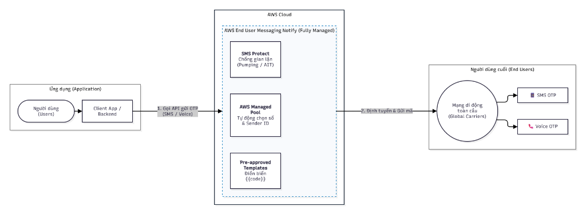

# 1AWS END USER MESSAGING NOTIFY – SEND OTPS IN MINUTES WITHOUT REGISTERING A DEDICATED SENDING NUMBER

When building applications, sending OTPs is one of the most common ways to verify users. However, with traditional SMS deployment on AWS, you may need to register phone numbers, configure sender IDs, and complete procedures with carriers. Depending on the country, this process can take anywhere from a few days to several weeks.

AWS End User Messaging Notify is designed to simplify that process. It is a managed authentication notification feature that allows applications to send OTPs through SMS or Voice using AWS-managed sender identities in supported countries.

Instead of handling telecommunications infrastructure themselves, developers can create a configuration, choose a template, and start sending OTPs in just a few minutes.

## WHAT MAKES IT NOTEWORTHY?

### 1. No need to register your own sending number

Notify can automatically select an AWS-managed phone number or sender ID based on the destination country. You do not need to purchase, register, or manage the lifecycle of a sending number yourself in supported markets.

However, some countries still require businesses to use their own sender identities to comply with local regulations.

### 2. Pre-approved OTP templates

AWS provides pre-approved authentication templates supporting multiple languages. Simply choose a suitable template and pass the OTP through the {{code}} variable.

This reduces the work involved in composing messages and handling template approval requirements with carriers.

### 3. Integrated SMS Protect fraud prevention

Every Notify configuration includes mandatory fraud protection to help detect and block traffic showing unusual patterns, such as:

- **SMS Pumping:** Attackers generate large numbers of SMS sending requests to drive up costs.
- **Artificially Inflated Traffic (AIT):** Message traffic generated or manipulated to profit from telecommunications fees.

SMS Protect is included in Notify pricing, with no separate SMS Protect charge. However, this mechanism helps mitigate risk rather than guaranteeing the complete elimination of all fraud.

### 4. Two flexible OTP implementation approaches

Notify supports two methods depending on the application's needs:

- **Application-generated codes:** Use SendNotifyTextMessage or SendNotifyVoiceMessage. The backend generates and manages OTPs, then passes the codes to Notify for delivery.
- **AWS-generated and validated codes:** Use SendNotifyCodeVerification and ValidateNotifyCodeVerification. AWS handles code generation, delivery, and verification according to the established configuration.

This lets developers choose between maintaining existing OTP logic and moving verification code management to AWS.

### 5. OTP delivery across multiple markets

Notify supports OTP delivery to multiple countries through SMS and Voice, with multilingual templates.

Availability depends on the service tier, destination country, and telecommunications requirements in each market.

## WHEN SHOULD YOU USE IT, AND WHAT SHOULD YOU CONSIDER?

Notify is particularly useful when verification codes need to be delivered quickly:

- Phone number verification during account registration or login.
- Authentication of payment transactions, money transfers, or sensitive operations.
- Account recovery and password resets.

## DEPLOYMENT CONSIDERATIONS

Although Notify simplifies OTP delivery, several points still require attention:

- **Regulatory compliance:** Businesses must still ensure an opt-in mechanism and meet carrier requirements in the destination country.
- **Check supported countries:** Not every country permits AWS-managed sender identities. Some markets require a dedicated phone number or sender ID.
- **Limit OTP requests:** Implement additional rate limiting, code expiration, and limits on failed verification attempts in the backend.
- **Monitor delivery results:** Use CloudWatch and messaging events to monitor status, detect errors, and control traffic.

## CONCLUSION

AWS End User Messaging Notify addresses one of the major barriers to deploying OTPs in the cloud: the time required to prepare messaging infrastructure.

Instead of registering sending numbers, configuring sender IDs, and handling numerous telecommunications procedures themselves, developers can leverage AWS-managed infrastructure to deliver OTPs quickly in supported markets.

With pre-approved templates, built-in SMS Protect, APIs supporting both code generation and validation, and spending controls, Notify is worth considering for applications that need user verification through SMS or Voice.

However, before production deployment, businesses still need to assess actual costs, service limits, and compliance requirements in each country.

## REFERENCES

- AWS – What is AWS End User Messaging?: https://docs.aws.amazon.com/end-user-messaging/latest/userguide/nx-overview.html
- AWS – Getting started with Notify: https://docs.aws.amazon.com/sms-voice/latest/userguide/notify-getting-started.md
- AWS – Notify quotas and limits: https://docs.aws.amazon.com/sms-voice/latest/userguide/notify-quotas.html
- AWS – AWS End User Messaging Pricing: https://aws.amazon.com/end-user-messaging/pricing/

#AWS #EndUserMessaging #Notify #OTP #CloudSecurity #AWSStudyGroupVN #FCAJ

[Open source document (OneDrive)](https://1drv.ms/w/c/b0f7e1f2c77d799c/IQAPyphz-uwZRar_iN0SDkmLAbw84B65MQLlPHdUTEXavBA?e=Xk3pza)

> Source document provided by the user; the publication date or AWS Study Group post link has not been verified.

### Architecture diagram

