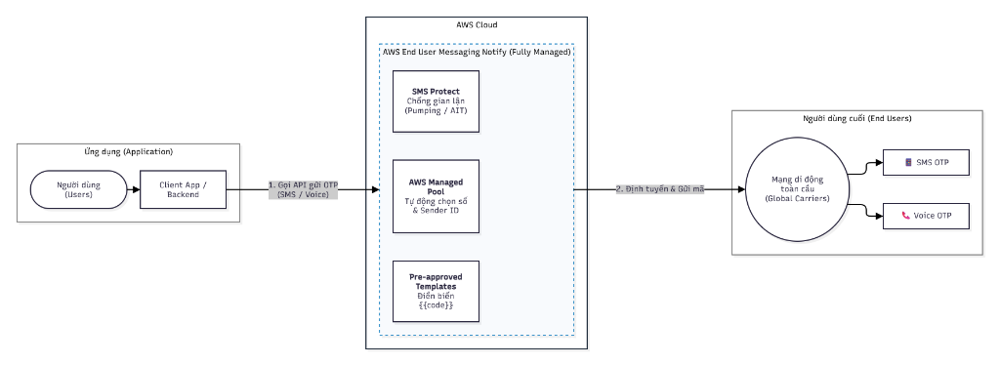

# 1AWS END USER MESSAGING NOTIFY – GỬI OTP TRONG VÀI PHÚT, KHÔNG CẦN ĐĂNG KÝ SỐ GỬI RIÊNG

Tóm tắt: AWS End User Messaging Notify hỗ trợ OTP qua SMS/Voice với danh tính gửi được quản lý tại các thị trường hỗ trợ; bài viết đề cập SMS Protect, giới hạn tốc độ, thời hạn OTP và yêu cầu tuân thủ.

[Mở tài liệu nguồn (OneDrive)](https://1drv.ms/w/c/b0f7e1f2c77d799c/IQAPyphz-uwZRar_iN0SDkmLAbw84B65MQLlPHdUTEXavBA?e=Xk3pza)

> Tài liệu nguồn do người dùng cung cấp; chưa xác nhận ngày xuất bản hoặc liên kết đăng trên AWS Study Group.

### Sơ đồ kiến trúc

