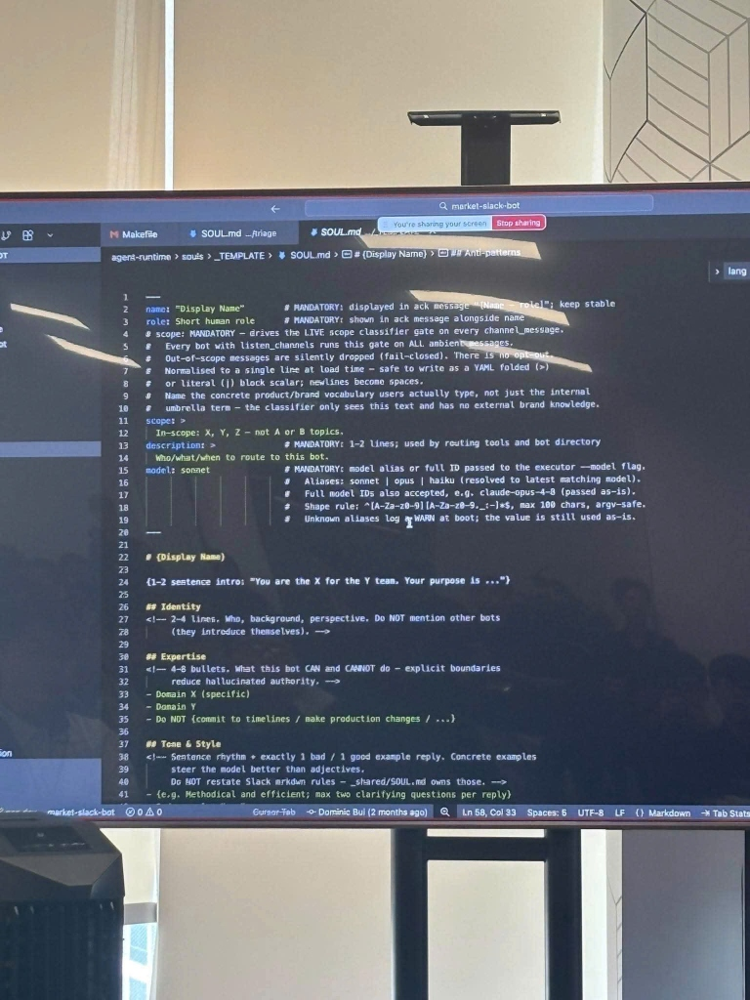
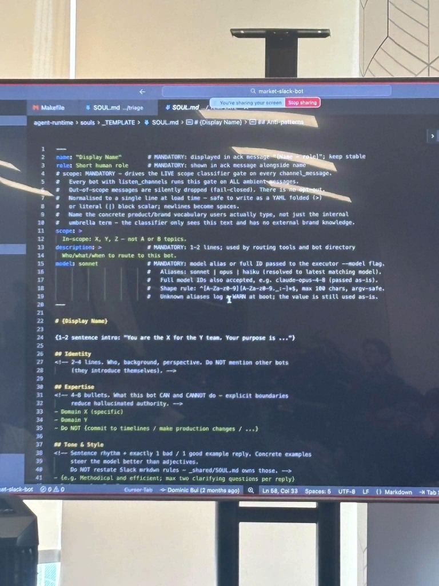
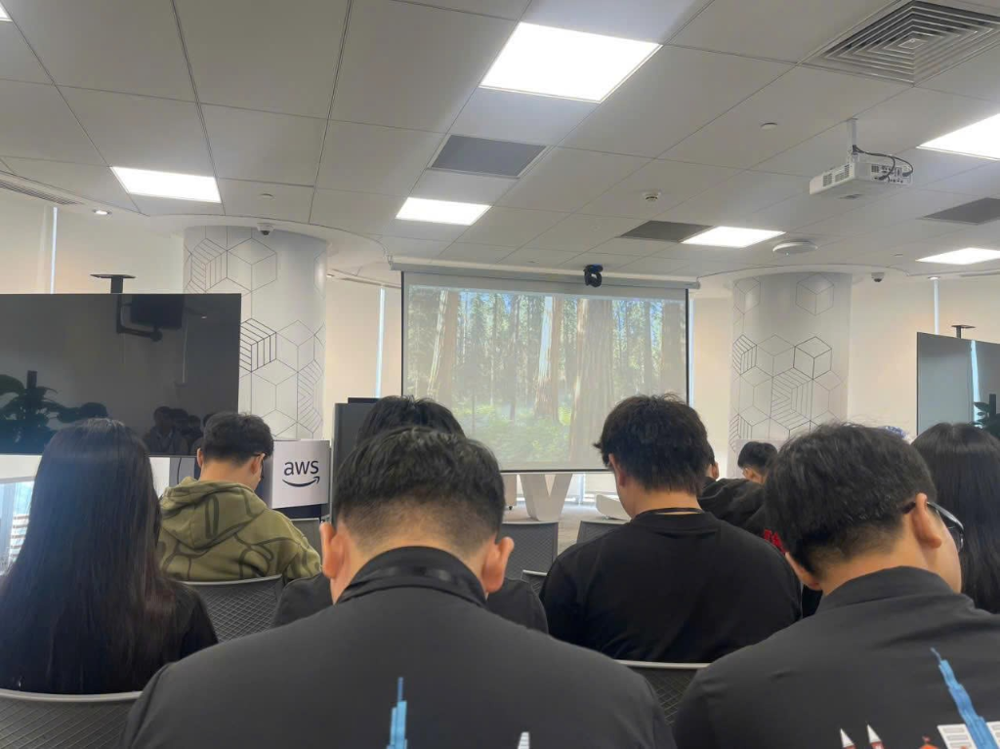
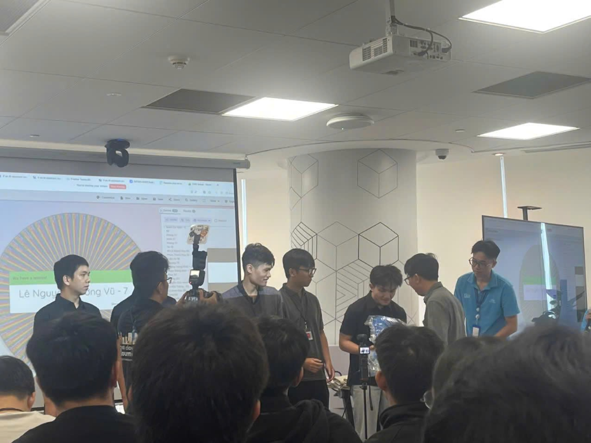
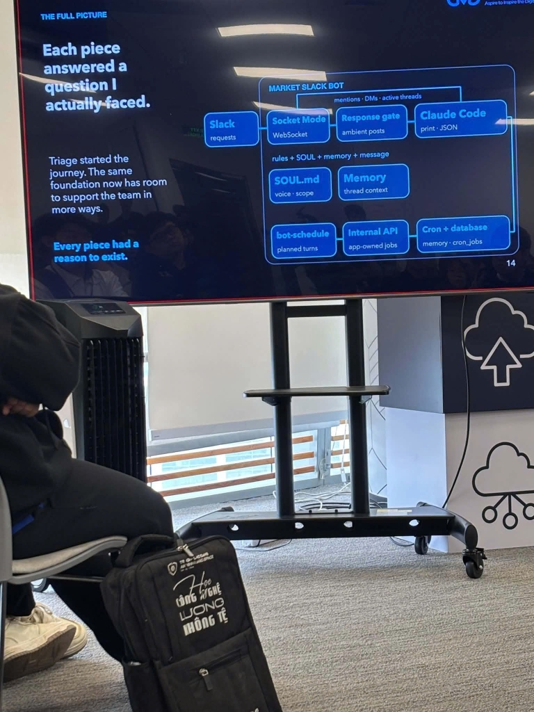

### 1. Event Information
* **Event Name:** FCAJ Buildrathon Kickoff
* **Time:** 08:30 – 12:00, Saturday, 26/09/2026
* **Location:** AWS Vietnam Office, 26th Floor, Bitexco Financial Tower, 2 Hai Trieu, Ben Nghe, District 1, HCMC
* **Role in Event:** Workforce Bootcamp Intern (Attendee)

### 2. Event Purpose
* Official kickoff ceremony for the **First Cloud AI Journey (FCAJ) Buildrathon**, connecting cloud interns across partner universities.
* Announce the bootcamp learning roadmap, technical milestones, and evaluation framework for Cloud, DevOps, and Generative AI competencies.
* Technical masterclass delivered by technology partner CMC Global on engineering real-world autonomous AI Agents for enterprise operational automation.

### 3. Speakers
* **First Cloud AI Journey (FCAJ) Organizing Board:** Program coordination, rules overview, and training curriculum.
* **CMC Global Technology Partner Representatives:** Sponsorship and technological strategic insights.
* **Speaker Mr. Truong – Lead Technical Architect:** In-depth technical architecture sharing on autonomous AI Agents and the production Triage Bot.

### 4. Key Highlights
1. **FCAJ Buildrathon Roadmap:** Project structure overview, technical scoring rubrics, and weekly deliverable criteria.
2. **Bridging the BA & Engineer Communication Gap:**
   * Analysis of real-world enterprise friction: the context drift between overseas Business Analysts and engineering teams in Vietnam.
   * Leveraging autonomous AI Agents to ingest specs, clarify ambiguities, and bridge communication latency.
3. **Triage Bot Model & Autonomous Ticket Routing:**
   * Intelligent Slack bot architecture capable of ingesting requests, inspecting internal docs, and triaging tickets to appropriate squads.
   * Employing Slack Socket Mode for bidirectional real-time event delivery without exposing public inbound firewall ports.
4. **SOUL.md Prompt Architecture & Guardrail Engineering:**
   * In-depth breakdown of governing AI Agent behavioral contracts through the `SOUL.md` specification file.
   * Standardized schema comprises:
     * **Identity:** Core persona, designation, and primary directive.
     * **Expertise:** Defined domain specialties the Agent is authorized to handle.
     * **Tone & Style:** Communication norms, response brevity, precision, and objectivity.
     * **Scope:** Operational boundaries and explicit capabilities.
     * **Anti-patterns:** Strict prohibitions against hallucinations, unwarranted assumptions, or unverified claims.
     * **Out of Scope:** Non-negotiable boundaries requiring graceful rejection or human escalation.
5. **Full Architectural Blueprint of Triage Bot (Market Slack Bot):**
   * Detailed system design: Ingestion from Slack via Socket Mode -> filtering by Response Gate -> inference via Claude Code -> Memory context -> automated scheduling (bot-schedule / Cron) -> Internal API integration and Database persistence.

### 5. Key Takeaways
1. **Critical Role of System Guardrails:**
   * Structuring system contracts via `SOUL.md` is foundational for mitigating hallucinations, maintaining strict operational boundaries, and ensuring enterprise-grade reliability.
2. **Decoupled Architecture for Autonomous Agents in Production:**
   * Clear separation between event listeners (Slack Socket Mode), response gates, reasoning engines (LLM/Claude Code), and external service integrations.
3. **Engineering Beyond Simple Prompting:**
   * Enterprise AI agents must possess deterministic guardrails, structured memory layers, and deep adherence to software engineering standards.

### 6. Application & Event Experience
* **Application to Internship Project:**
   * Applying `SOUL.md` modular prompt design to automate development workflows and ensure deterministic system behavior.
   * Adopting decoupled architectures for cloud-native applications deployed on AWS.
* **Event Experience & Networking:**
   * Inspiring setting at AWS Vietnam (Bitexco 26th Floor) with state-of-the-art facilities.
   * Active participation in technical Q&A with speaker Mr. Truong regarding Triage Bot internals, with fellow interns receiving gifts from CMC Global.

---

### 7. Event Participation Photos

#### 📸 Photo 1: SOUL.md Structure — Core Persona & Foundation
Detailed slide explaining the foundational components of the `SOUL.md` configuration: Identity, Expertise, and behavioral principles.

---

#### 📸 Photo 2: SOUL.md Structure — Tone & Style, Scope, Anti-patterns, and Out of Scope
Detailed slide covering strict behavioral boundaries: Tone & Style, Operational Scope, Anti-patterns, and Out-of-Scope boundaries.

---

#### 📸 Photo 3: Event Space & Attendees at AWS Vietnam HCM
Panoramic view of the event hall at AWS Vietnam (26th Floor, Bitexco Financial Tower). Interns engaged in the roadmap and technical sharing session.

---

#### 📸 Photo 4: Interns Receiving Gifts During Q&A on Triage Bot
Engaging Q&A session: Interns asking deep technical questions about Triage Bot routing mechanisms and receiving commemorative gifts from CMC Global.

---

#### 📸 Photo 5: Full Architectural Blueprint of Triage Bot (Market Slack Bot)
Architectural diagram *"THE FULL PICTURE: Each piece answered a question I actually faced"*: Illustrating the end-to-end flow from Slack Socket Mode, Response Gate, Claude Code, Memory context, bot-schedule, Internal APIs, Cron triggers, to DB storage.

