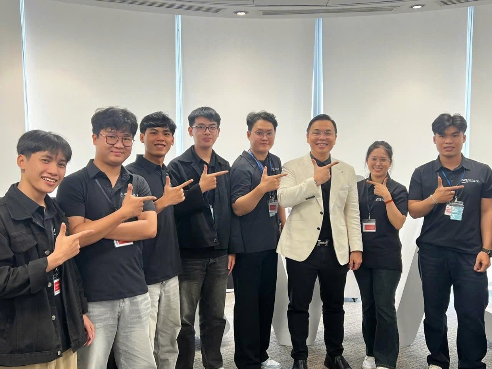

### 1. Thông tin sự kiện
* **Tên sự kiện:** FCAJ Buildrathon Kickoff
* **Thời gian:** 08:30 – 12:00, Thứ Bảy, 26/09/2026
* **Địa điểm:** Văn phòng AWS Việt Nam, Tầng 26, Tháp Bitexco Financial Tower, Số 2 Hải Triều, Bến Nghé, Quận 1, TP.HCM
* **Vai trò trong sự kiện:** Thực tập sinh tham dự (Workforce Bootcamp Intern)

### 2. Mục đích của sự kiện
* Lễ khởi động chính thức chuỗi hoạt động **First Cloud AI Journey (FCAJ) Buildrathon**, kết nối mạng lưới thực tập sinh đám mây và sinh viên các trường đại học đối tác.
* Phổ biến lộ trình đào tạo, khung đánh giá kỹ năng Cloud, DevOps và Generative AI trong toàn bộ chương trình thực tập.
* Buổi chia sẻ chuyên sâu từ đối tác công nghệ CMC Global về kinh nghiệm phát triển, triển khai các giải pháp AI Agent tự động hóa vận hành thực tế trong doanh nghiệp.

### 3. Danh sách diễn giả (Speakers)
* **Ban tổ chức First Cloud AI Journey (FCAJ):** Điều phối chương trình, phổ biến quy chế đánh giá và lộ trình đào tạo.
* **Đại diện đối tác công nghệ CMC Global:** Đồng hành tài trợ và chia sẻ định hướng công nghệ tại doanh nghiệp.
* **Diễn giả anh Trường – Lead Technical Architect:** Trực tiếp trình bày giải pháp kiến trúc AI Agent và mô hình Triage Bot ứng dụng trong dự án thực tế.

### 4. Nội dung nổi bật (Key Highlights)
1. **Lộ trình FCAJ Buildrathon:** Giới thiệu cấu trúc đề tài, tiêu chí chấm điểm kỹ thuật và quy chuẩn báo cáo hàng tuần của chương trình thực tập.
2. **Khoảng cách giao tiếp giữa BA và Kỹ sư:**
   * Diễn giả phân tích bài toán thực tế thường gặp trong các dự án công nghệ: Khoảng cách giữa yêu cầu nghiệp vụ từ Business Analyst (BA làm việc tại nước ngoài) và đội ngũ kỹ sư phát triển (Engineer tại Việt Nam).
   * Sự sai lệch ngữ cảnh (context drift) và độ trễ phản hồi dẫn đến chậm trễ tiến độ dự án.
3. **Mô hình Triage Bot & Tự động hóa phân loại:**
   * Giới thiệu kiến trúc bot Slack thông minh, tự động tiếp nhận yêu cầu, phân tích nội dung, đối chiếu tài liệu nội bộ và phân loại luồng công việc cho đúng nhóm phụ trách.
   * Sử dụng Slack Socket Mode để nhận diện sự kiện thời gian thực (real-time events) mà không cần mở port Public Inbound.
4. **Kỹ thuật thiết kế tệp cấu hình SOUL.md:**
   * Diễn giả phân tích chuyên sâu về việc thiết lập rào chắn kiểm soát (Guardrails) cho AI Agent thông qua tệp đặc tả `SOUL.md`.
   * Cấu trúc chuẩn bao gồm:
     * **Identity:** Xác định định danh, vai trò cốt lõi và sứ mệnh của Agent.
     * **Expertise:** Danh mục lĩnh vực chuyên môn kỹ thuật mà Agent được huấn luyện xử lý.
     * **Tone & Style:** Định hình văn phong giao tiếp, chuẩn mực phản hồi (ngắn gọn, chính xác, khách quan).
     * **Scope:** Giới hạn phạm vi công việc được phép thực thi.
     * **Anti-patterns:** Danh sách các hành vi sai lệch, giả định vô căn cứ hoặc suy đoán cần tuyệt đối tránh.
     * **Out of Scope:** Các nghiệp vụ vượt thẩm quyền cần từ chối hoặc chuyển tiếp cho con người.
5. **Kiến trúc toàn cảnh của dự án Triage Bot (Market Slack Bot):**
   * Diễn giả trình bày sơ đồ tổng thể hệ thống: Luồng dữ liệu đi từ người dùng trên Slack qua Socket Mode -> bộ lọc phản hồi (Response Gate) -> điều phối qua Claude Code / LLM Engine -> bộ nhớ ngữ cảnh (Memory) -> lập lịch tự động (bot-schedule / Cron) -> tích hợp Internal API và lưu trữ dữ liệu vào Database.

### 5. Những gì học được (Key Takeaways)
1. **Tầm quan trọng của System Guardrails:**
   * Việc thiết kế tệp cấu hình như `SOUL.md` là yếu tố then chốt giúp kiểm soát chất lượng phản hồi của LLM, triệt tiêu hiện tượng ảo giác (hallucination) và đảm bảo an toàn vận hành trong doanh nghiệp.
2. **Kiến trúc phân tầng của AI Agent trong môi trường Production:**
   * Hiểu rõ cách tách biệt giữa tầng giao tiếp sự kiện (Slack Socket Mode), tầng lọc điều phối (Response Gate), tầng suy luận (LLM/Claude Code) và tầng tích hợp hệ thống (Internal API/DB).
3. **Phương pháp tiếp cận giải quyết bài toán nghiệp vụ:**
   * AI không chỉ dùng để sinh văn bản đơn thuần mà phải được thiết kế như một tác nhân tự hành (Autonomous Agent) có ngữ cảnh, có bộ nhớ và tuân thủ chặt chẽ quy trình của doanh nghiệp.

### 6. Ứng dụng vào công việc & Trải nghiệm trong event
* **Ứng dụng vào đề tài thực tập:**
   * Áp dụng nguyên lý cấu trúc `SOUL.md` vào việc thiết lập prompt rào chắn an toàn cho các tác vụ tự động hóa và đồ án xây dựng hệ thống trên AWS.
   * Vận dụng kiến trúc tách biệt luồng xử lý (Decoupled Architecture) và quản lý trạng thái an toàn trong thiết kế giải pháp đám mây.
* **Trải nghiệm và kết nối (Networking):**
   * Không gian văn phòng AWS tại Tầng 26 Bitexco hiện đại, trang thiết bị chuẩn mực và tầm nhìn toàn cảnh TP.HCM tạo nguồn cảm hứng rất lớn.
   * Tham gia phiên thảo luận, đặt câu hỏi trực tiếp với diễn giả anh Trường về kiến trúc Triage Bot và các bạn thực tập sinh sôi nổi nhận quà khích lệ từ CMC Global.

---

### 7. Một số hình ảnh khi tham gia sự kiện

#### 📸 Ảnh 1: Cấu trúc SOUL.md — Thành phần cốt lõi và định hình Agent
Ảnh trình bày chi tiết về phần mở đầu của tệp cấu hình `SOUL.md`: Thiết lập nhân dạng (Identity), năng lực chuyên môn (Expertise), và nguyên tắc định hình nhân cách vận hành cho AI Agent.

---

#### 📸 Ảnh 2: Cấu trúc SOUL.md — Tone & Style, Scope, Anti-patterns và Out of Scope
Ảnh trình bày chi tiết về các quy định hành vi nghiêm ngặt: Văn phong phản hồi (Tone & Style), phạm vi thẩm quyền (Scope), các lỗi hành vi cần triệt tiêu (Anti-patterns) và các nhiệm vụ ngoài phạm vi (Out of Scope).

---

#### 📸 Ảnh 3: Không gian sự kiện và các bạn thực tập sinh tham gia tại AWS HCM
Toàn cảnh hội trường tại Văn phòng AWS Việt Nam (Tầng 26, Bitexco Financial Tower). Các bạn thực tập sinh FCAJ tập trung lắng nghe phần trình bày lộ trình và chia sẻ kỹ thuật.

---

#### 📸 Ảnh 4: Các bạn nhận quà khi tham gia thảo luận Q&A về Triage Bot
Không khí hào hứng trong phiên hỏi đáp: Các bạn thực tập sinh tích cực đặt câu hỏi chuyên sâu về cơ chế phân loại của Triage Bot và nhận quà lưu niệm từ diễn giả cũng như đại diện CMC Global.

---

#### 📸 Ảnh 5: Cấu trúc kiến trúc toàn cảnh dự án Triage Bot (Market Slack Bot)
Sơ đồ kiến trúc thực chiến *"THE FULL PICTURE: Each piece answered a question I actually faced"*: Minh họa luồng dữ liệu liên hoàn từ Slack Socket Mode, Response Gate, Claude Code, Memory context, bot-schedule, Internal API, Cron job đến cơ sở dữ liệu.

---

#### 📸 Ảnh 6: Chụp ảnh lưu niệm và giao lưu cùng diễn giả
Khoảnh khắc giao lưu, chụp ảnh kỷ niệm đáng nhớ của nhóm thực tập sinh cùng diễn giả tại văn phòng AWS Việt Nam sau khi kết thúc buổi chia sẻ kỹ thuật.

