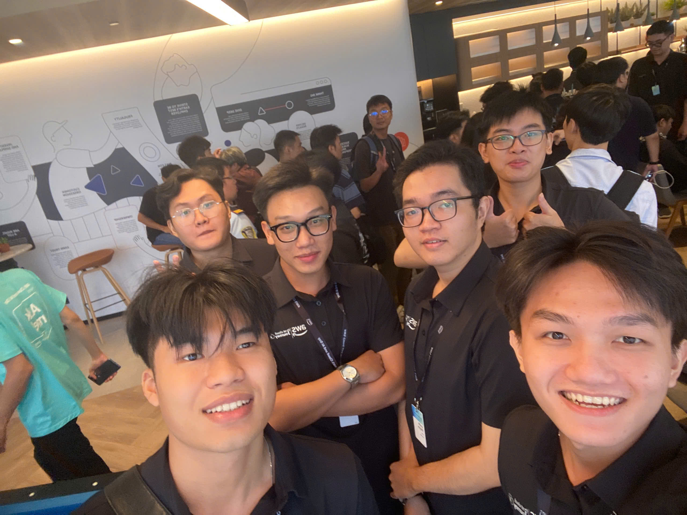
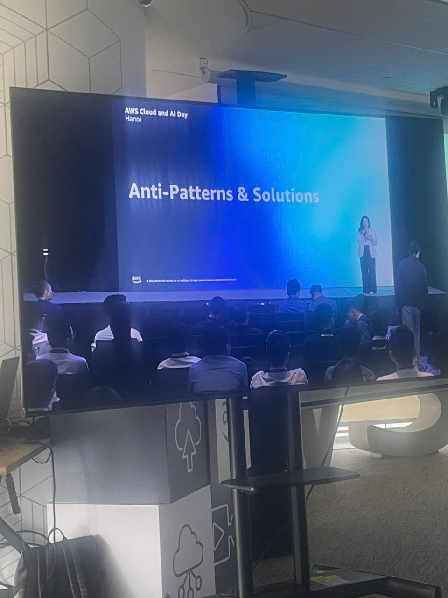
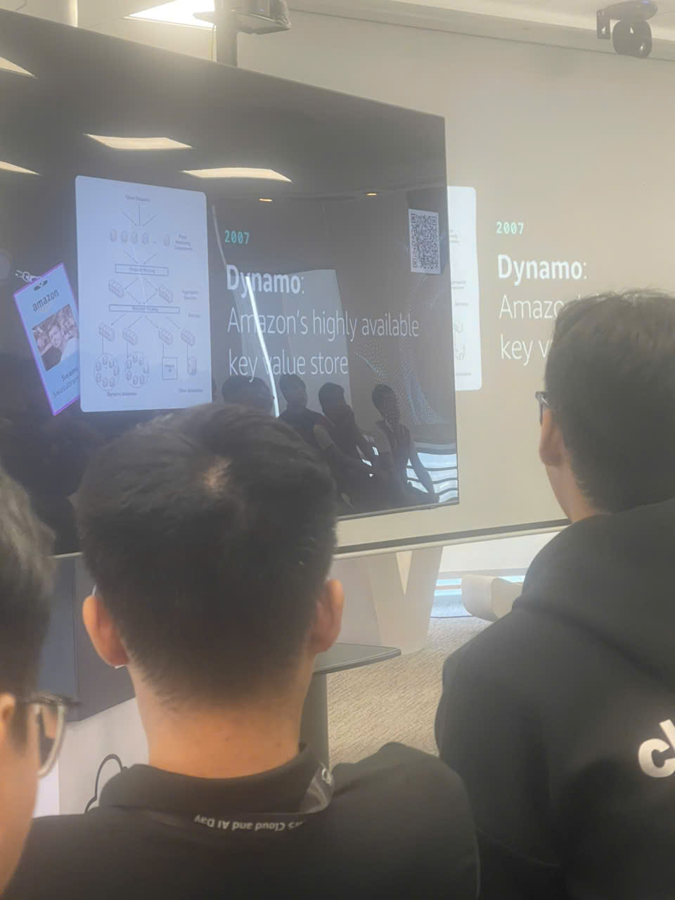

### 1. Event Information
* **Event Name:** AWS Cloud and AI Day Hanoi
* **Time:** Tuesday, 29/09/2026
* **Location:** National Convention Center / AWS Partner Venue, Hanoi, Vietnam
* **Role in Event:** Workforce Bootcamp Intern (Attendee)

### 2. Event Purpose
* Explore comprehensive modern cloud modernization strategies, scalable distributed systems architecture, and the emerging wave of enterprise Generative AI and autonomous AI Agents.
* Examine real-world engineering practices behind ultra-low latency, highly available, and massively scalable systems on AWS.
* Learn modern cloud-native DevSecOps practices, shift-left automated vulnerability detection, and defense-in-depth principles for production workloads.

### 3. Speakers
* **AWS Principal Solutions Architects & Technical Evangelists:** Delivering technical masterclasses on distributed storage (Amazon DynamoDB) and enterprise GenAI architectures.
* **CTOs & Technology Leaders from AWS Premier Partners:** Sharing production case studies on cloud modernization and enterprise autonomous agent deployments.
* **Security & Compliance Specialists:** Demonstrating automated cloud governance, threat detection, and continuous compliance frameworks.

### 4. Key Highlights
1. **Cloud Architecture & Extreme Scalability (Amazon Dynamo / DynamoDB):**
   * Architectural deep dive into building distributed systems with single-digit millisecond latency and 99.999% availability.
   * Applying core principles from the foundational *Amazon Dynamo Paper* (Consistent Hashing, Vector Clocks, Gossip Protocol, Sloppy Quorums) implemented within Amazon DynamoDB.
2. **AI Agents & AI-Native Enterprise Applications:**
   * Transitioning from prompt engineering to autonomous **AI Agents** featuring multi-step reasoning, external tool execution, and stateful memory.
   * Mitigating production challenges: hallucination containment, sensitive data isolation, and human-in-the-loop governance for critical transactions.
3. **AI-Assisted Software Engineering:**
   * Leveraging intelligent coding assistants (Amazon Q Developer, Claude Code) to accelerate developer feedback loops while preserving architectural discipline and security rigor.
4. **Cloud Security & DevSecOps (Shift-Left Practices):**
   * Embedding automated SAST/DAST and container vulnerability scans directly into CI/CD pipelines.
   * Enforcing principle of least privilege via AWS IAM, KMS encryption at rest, and real-time behavioral threat detection via Amazon GuardDuty and AWS Security Hub.
5. **AWS GenAI Ecosystem for Enterprises:**
   * Enterprise-scale Foundation Models on Amazon Bedrock, SageMaker JumpStart, and custom silicon infrastructure (AWS Trainium, Inferentia).

### 5. Key Takeaways
1. **Distributed Systems Mindset:**
   * Practical application of the CAP and PACELC theorems when trading consistency for availability in cloud-native design.
2. **Information Assurance in the GenAI Era:**
   * AI agents must be protected with deterministic guardrails, structured memory boundaries, and defense mechanisms against Prompt Injection and data exfiltration.
3. **Software Engineering Fundamentals as the True Differentiator:**
   * Deep mastery of computer science fundamentals (data structures, algorithms, operating systems, networking, and cryptography) remains paramount.

### 6. Application & Event Experience
* **Application to FCAJ Internship Project:**
   * Incorporating AWS Well-Architected Framework principles (Security and Reliability pillars) into weekly lab assignments and system designs.
   * Adopting strict least-privilege policies and decoupled service boundaries.
* **Event Experience & Networking:**
   * Engaging with AWS Solution Architects at the Ask-an-Architect booth and connecting with technology peers across partner organizations.

---

### 7. Event Participation Photos

#### 📸 Photo 1 (4.2.2): Panoramic View of AWS Cloud and AI Day Hanoi
Grand keynote hall during the opening session of AWS Cloud and AI Day Hanoi with industry practitioners, enterprise leaders, and cloud architects.

---

#### 📸 Photo 2 (4.2.3): Technical Session on Cloud Architecture & Distributed Systems
Deep-dive presentation on large-scale distributed architectures, fault-tolerant key-value stores, and cloud elasticity.

---

#### 📸 Photo 3 (4.2.4): AI Agent Evolution & AI-Native Architectures
Technical session detailing autonomous AI Agent reasoning, tool-use mechanisms, and multi-agent enterprise integration.

---

#### 📸 Photo 4 (4.2.5): Cloud DevSecOps & Security Governance
Best practices for shift-left security automation, IAM governance, and runtime security monitoring on AWS.

---

#### 📸 Photo 5 (4.2.6): Technology Demo Booths & Solution Architect Networking
Exploring hands-on AWS solution demos, Generative AI showcases, and technical discussions at the Ask-an-Architect area.

