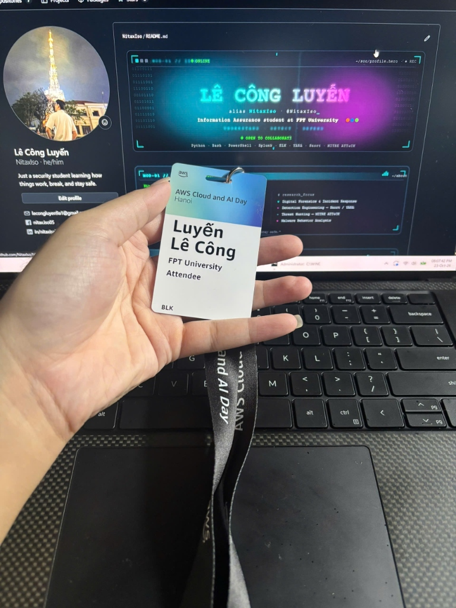
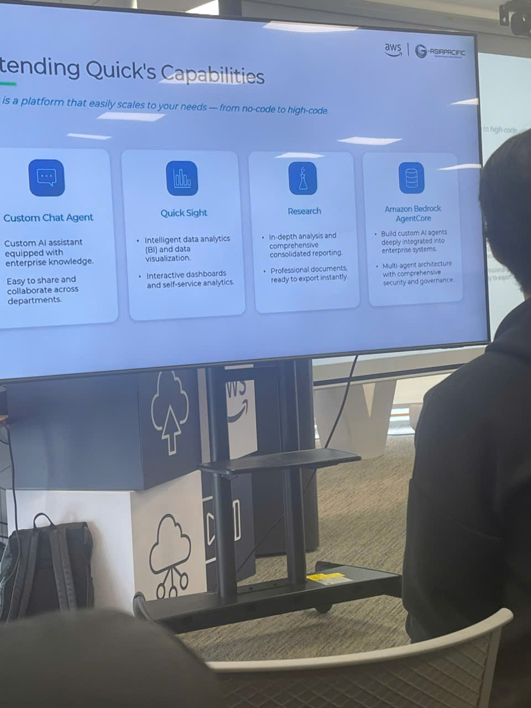
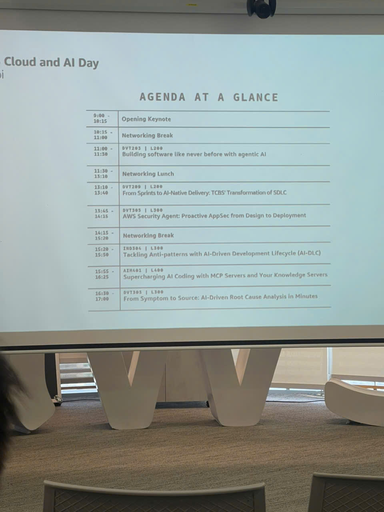

### 1. Thông tin sự kiện
* **Tên sự kiện:** AWS Cloud and AI Day Hanoi
* **Thời gian:** Thứ Ba, 29/09/2026
* **Địa điểm:** Trung tâm Hội nghị Quốc gia / Khách sạn đối tác AWS, Hà Nội, Việt Nam
* **Vai trò trong sự kiện:** Thực tập sinh tham dự (Workforce Bootcamp Intern - Attendee)

### 2. Mục đích của sự kiện
* Tiếp cận bức tranh toàn cảnh về xu hướng hiện đại hóa hạ tầng điện toán đám mây và làn sóng ứng dụng Trí tuệ nhân tạo thế hệ mới (Generative AI & AI Agent).
* Tìm hiểu kiến trúc thực tiễn của các hệ thống phân tán chịu tải lớn, đảm bảo tính sẵn sàng cao (High Availability) và khả năng mở rộng quy mô (Scalability).
* Cập nhật các phương pháp tích hợp bảo mật xuyên suốt (DevSecOps, Shift-left Security) và thực hành tốt nhất trong quản trị vận hành môi trường Cloud-Native.

### 3. Danh sách diễn giả (Speakers)
* **AWS Principal Solutions Architects & Technical Evangelists:** Trình bày chuyên sâu về hạ tầng phân tán, kiến trúc lưu trữ NoSQL và hệ sinh thái GenAI trên AWS.
* **Lãnh đạo Công nghệ & Chuyên gia Kỹ thuật đối tác AWS:** Chia sẻ case-study thực tế từ các doanh nghiệp quy mô lớn về chuyển đổi số, di chuyển hạ tầng và triển khai AI Agent vào quy trình nghiệp vụ.
* **Security & Compliance Specialists:** Giới thiệu các khung giải pháp phòng thủ chuyên sâu, tự động hóa kiểm toán và bảo mật đám mây.

### 4. Nội dung nổi bật (Key Highlights)
1. **Kiến trúc Cloud và khả năng mở rộng hệ thống (Amazon Dynamo / DynamoDB):**
   * Diễn giả phân tích chuyên sâu về bài toán thiết kế hệ thống phân tán có độ trễ cực thấp (Single-digit millisecond latency) và tính sẵn sàng 99.999%.
   * Nguyên lý thiết kế từ bài báo học thuật kinh điển *Amazon Dynamo Paper* (Consistent Hashing, Vector Clocks, Gossip Protocol, Sloppy Quorums) được hiện thực hóa qua dịch vụ quản lý toàn diện Amazon DynamoDB, giúp hệ thống chịu tải hàng triệu request mỗi giây mà không suy giảm hiệu năng.
2. **AI Agent và xu hướng ứng dụng AI-Native:**
   * Xu hướng dịch chuyển từ Prompting đơn thuần sang hệ thống **AI Agent tự hành**: Có khả năng lập kế hoạch (Reasoning/Planning), sử dụng công cụ (Tool Use / Function Calling) và lưu trữ trạng thái ngữ cảnh (State & Memory).
   * Rào cản và thách thức thực tế trong doanh nghiệp: Hiện tượng ảo giác (hallucination), kiểm soát dữ liệu nhạy cảm, và cơ chế con người can thiệp (Human-in-the-loop) để phê duyệt các hành động có mức độ rủi ro cao.
3. **Phát triển phần mềm với sự hỗ trợ của AI (AI-Assisted Software Engineering):**
   * Tích hợp các công cụ trợ lý lập trình thông minh (Amazon Q Developer, Claude Code) vào IDE nhằm tăng tốc chu kỳ phát triển.
   * Diễn giả nhấn mạnh nguyên tắc: AI là bộ đòn bẩy gia tăng năng suất (Productivity Multiplier), nhưng kỹ sư vẫn là người chịu trách nhiệm tối thượng về tính đúng đắn của logic, cấu trúc kiến trúc và chuẩn mực bảo mật.
4. **Bảo mật và vận hành hệ thống Cloud (DevSecOps & Shift-Left):**
   * Tích hợp kiểm tra bảo mật tự động (SAST/DAST, Container Vulnerability Scanning) trực tiếp vào pipeline CI/CD trước khi mã nguồn được triển khai.
   * Quản trị quyền truy cập theo nguyên tắc đặc quyền tối thiểu (Least Privilege) với AWS IAM, bảo vệ dữ liệu nhạy cảm qua KMS encryption và giám sát đe dọa thời gian thực qua AWS Security Hub & GuardDuty.
5. **Hệ sinh thái dịch vụ AWS cho GenAI doanh nghiệp:**
   * Toàn cảnh các dịch vụ: Amazon Bedrock (Serverless Foundation Models), Amazon SageMaker JumpStart, và các giải pháp hạ tầng tối ưu phần cứng (AWS Trainium, Inferentia).

### 5. Những gì học được (Key Takeaways)
1. **Tư duy thiết kế hệ thống phân tán (Distributed Systems Mindset):**
   * Hiểu rõ sự đánh đổi trong Định lý CAP/PACELC giữa tính nhất quán (Consistency) và tính sẵn sàng (Availability) khi xây dựng các ứng dụng trên đám mây.
2. **Góc nhìn An toàn thông tin trong kỷ nguyên GenAI:**
   * Mô hình AI không thể hoạt động như một hộp đen không kiểm soát; phải thiết lập các tầng rào chắn (Guardrails), phân loại dữ liệu đầu vào/đầu ra và ngăn chặn các vectơ tấn công mới như Prompt Injection hay Data Leakage.
3. **Giá trị cốt lõi của người kỹ sư:**
   * Nền tảng khoa học máy tính cốt lõi (Data Structures, Algorithms, Network, OS, Security) là yếu tố quyết định giúp phân biệt một kỹ sư làm chủ công nghệ với một người chỉ biết gõ lệnh hỗ trợ từ chatbot.

### 6. Ứng dụng vào công việc & Trải nghiệm trong event
* **Ứng dụng vào đề tài thực tập FCAJ:**
   * Thiết kế kiến trúc bài Lab và đồ án thực tập tuân thủ chặt chẽ 6 trụ cột của **AWS Well-Architected Framework** (đặc biệt là 2 trụ cột Security và Reliability).
   * Áp dụng tư duy phân tách thành phần (Decoupling) và kiểm soát truy cập nghiêm ngặt khi tích hợp các dịch vụ Cloud & AI.
* **Trải nghiệm và kết nối (Networking):**
   * Sự kiện quy tụ đông đảo các chuyên gia đầu ngành tại Hà Nội, mang lại không khí trao đổi học thuật sôi nổi và cơ hội mở rộng mối quan hệ chuyên môn.
   * Được trực tiếp trải nghiệm các gian hàng demo công nghệ tương tác, trao đổi kỹ thuật với các AWS Solution Architects tại quầy Ask-an-Architect.

---

### 7. Một số hình ảnh khi tham gia sự kiện

#### 📸 Ảnh 1 (event_checkin_badge.jpg): Thẻ đeo tham dự sự kiện (Attendee Check-in Badge)
Minh chứng check-in chính thức tại sự kiện AWS Cloud and AI Day Hanoi: Thẻ đeo mang tên thực tập sinh Lê Công Luyến (FPT University - Attendee) cùng dây đeo nhận diện chính hãng từ ban tổ chức AWS trên nền máy tính cá nhân.

---

#### 📸 Ảnh 2 (event_hall_keynote.jpg): Không gian toàn cảnh sự kiện AWS Cloud and AI Day Hanoi
Toàn cảnh không gian hội trường lớn tại sự kiện AWS Cloud and AI Day Hanoi và phiên khai mạc với sự tham gia của đông đảo cộng đồng công nghệ, doanh nghiệp và các kỹ sư đám mây.

---

#### 📸 Ảnh 3 (cloud_architecture_dynamo.jpg): Phiên trình bày kỹ thuật về Kiến trúc Cloud & Hệ thống phân tán
Diễn giả phân tích chuyên sâu về kiến trúc hệ thống quy mô lớn, khả năng chịu lỗi, mô hình dữ liệu NoSQL phân tán và các nguyên lý mở rộng hạ tầng đám mây.

---

#### 📸 Ảnh 4 (ai_agent_trends.jpg): Xu hướng phát triển AI Agent & Ứng dụng AI-Native
Phiên thuyết trình về kiến trúc AI Agent trong môi trường doanh nghiệp: Cơ chế reasoning, tích hợp tools và cách phối hợp giữa các Agent tự hành.

---

#### 📸 Ảnh 5 (devsecops_cloud_security.jpg): Tích hợp Bảo mật DevSecOps & Quản trị rủi ro Cloud
Phiên chia sẻ về chiến lược bảo mật Shift-left, quản trị danh tính IAM, tự động hóa kiểm tra an toàn thông tin và giám sát đe dọa thời gian thực trên AWS.

---

#### 📸 Ảnh 6 (technology_demo_booths.jpg): Trải nghiệm khu vực Demo công nghệ & Trao đổi kỹ thuật
Khu vực gian hàng demo các giải pháp đám mây, các sản phẩm ứng dụng Generative AI và không gian thảo luận trực tiếp cùng các chuyên gia giải pháp AWS.

